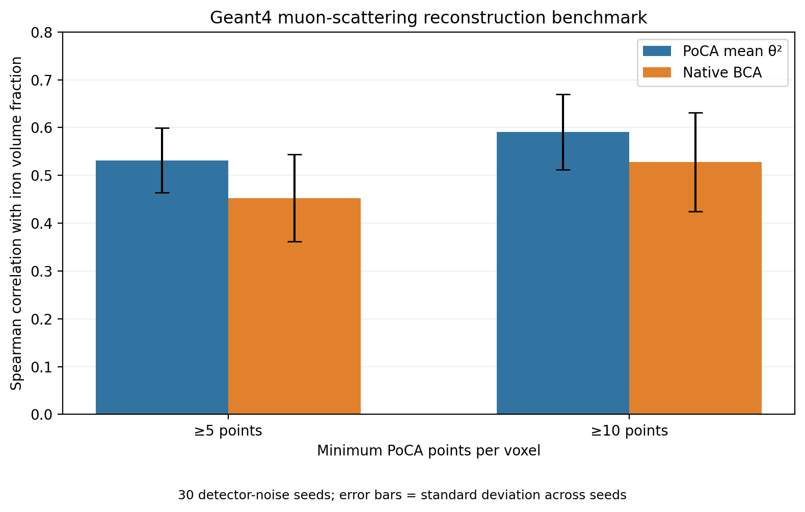

# Geant4 Muon-Scattering Tomography Benchmark

## Overview

This research benchmark evaluates muon-scattering reconstruction
using Geant4 simulations and the Muograph Python framework.

The study compares:

- PoCA mean squared scattering-angle scoring
- Angle-only pairwise clustering
- Muograph's native Binned Clustering Algorithm (BCA)

The primary evaluation metric is Spearman rank correlation
between reconstructed voxel scores and known iron volume fraction.

## Simulation

The simulation uses Geant4 with the FTFP_BERT physics list.

| Parameter | Configuration |
|---|---|
| Particle | Negative muon |
| Initial kinetic energy | 4 GeV |
| Generated events | 10,000 |
| Source | 600 x 600 mm square at z = 1800 mm |
| Direction | Uniform in solid angle within a 15-degree downward cone |
| Target | 500 x 500 x 200 mm iron block, centered at origin |
| Environment | Air |
| Detector planes (mm) | +1400, +1000, +600, -600, -1000, -1400 |
| Detector acceptance | +/-300 mm in x and y |
| Position resolution | 1 mm Gaussian smearing in x and y |
| Reconstruction volume | 600 x 600 x 400 mm |
| Voxel width | 100 mm |

The detector planes are virtual crossing surfaces. Detector
acceptance and position smearing are implemented in the analysis.

The simulation is a controlled benchmark and does not model a
realistic cosmic-ray energy spectrum or detector response.

## Reference dataset

The included dataset is located at:

simulation/muon_scattering/results/benchmark_10000/spacing_400mm/

Files:

- muon_hits.csv: Virtual detector crossings
- muon_truth.csv: Generated muon information
- muon_boundaries.csv: Recorded material-boundary crossings

There are 10,000 generated muons, of which 1,606 satisfy the
six-plane geometric acceptance requirement.

Note: The intersects_iron_geometry field in the truth CSV uses
an initial-position footprint check and is not a reliable
intersection label for inclined trajectories. Recorded boundary
crossings should be used for trajectory-level iron-intersection
checks.

## Reconstruction

The analysis uses corrected Muograph track-orientation and
scattering-angle calculations.

Of the 1,606 geometrically accepted tracks, 1,081 reconstructed
PoCA points fall inside the volume of interest for noise seed 42.

Reconstruction methods are compared using matched PoCA events,
voxel assignments, and occupancy masks.

The native BCA configuration uses its default parameters with
momentum weighting disabled.

## Matched benchmark: noise seed 42

Spearman correlation with known iron volume fraction:

| Minimum points/voxel | PoCA mean theta^2 | Native BCA |
|---|---:|---:|
| 3 | 0.6006 | 0.3899 |
| 5 | 0.6675 | 0.5141 |
| 10 | 0.7641 | 0.6457 |
| 15 | 0.7810 | 0.6873 |

## Detector-noise robustness

Thirty independent detector-position-noise realizations
(seeds 42 through 71) were evaluated using the same underlying
Geant4 trajectories.

| Metric | >=5 points | >=10 points |
|---|---:|---:|
| Mean PoCA correlation | 0.5313 | 0.5908 |
| Mean native BCA correlation | 0.4526 | 0.5280 |
| Mean paired difference | +0.0787 | +0.0629 |
| Standard deviation of difference | 0.0642 | 0.0950 |
| PoCA wins | 27/30 | 23/30 |

The 95% t-intervals for the mean paired differences, conditional
on the fixed simulated muon sample, were:

- >=5 points: [0.0548, 0.1027]
- >=10 points: [0.0274, 0.0983]

These intervals do not describe uncertainty across independent
Geant4 event populations.

## Reproduction

The benchmark requires a working Muograph environment with
PyTorch, NumPy, pandas, SciPy, Matplotlib, and Jupyter.

Open the notebooks with the working directory set to research/:

1. 11_geant4_native_bca_benchmark_clean.ipynb
2. 12_geant4_bca_noise_robustness_clean.ipynb

Both notebooks have been executed successfully from fresh kernels
against the included reference dataset.

CPU execution was used for validation on Apple Silicon.

Geant4 and CMake are required only to regenerate simulated data.

The Geant4 source and run macros are located in:

simulation/muon_scattering/

The provided CSVs should be used for exact reproduction of the
reported benchmark, because regeneration may produce different
random trajectories.

## Interpretation and limitations

Under the tested conditions, PoCA mean-theta-squared scoring
achieved higher average rank correlation with known iron volume
fraction than native BCA.

Scoring ablations suggest that relatively large scattering
angles contribute useful discrimination, while pairwise-distance
weighting does not consistently improve or worsen correlation.

This result is specific to the simulated target, source spectrum,
detector configuration, voxelization, evaluation metric, and
default BCA settings.

The benchmark does not establish that PoCA generally outperforms
BCA or that the reconstructed scores are calibrated physical
scattering-density estimates.

The noise realizations share the same generated muon population,
and adjacent voxel measurements are not statistically independent.

## Benchmark visualization

Mean Spearman correlations over 30 detector-noise realizations,
with standard-deviation error bars. The same Geant4 muon
population is reused for every realization.

Regenerate the figure from the verified summary statistics:

    python research/plot_benchmark_summary.py

## Reproducing the benchmark from a fresh clone

The benchmark requires the corrected tracking implementation in
this fork, rather than the original Muograph package from PyPI.

### Installation

Clone the research branch:

    git clone --branch research/geant4-bca-benchmark https://github.com/mlkrbk/muograph.git
    cd muograph

Install dependencies using Poetry:

    poetry install

Alternatively, in a compatible Python environment:

    python -m pip install -e .
    python -m pip install jupyter nbconvert

The benchmark was validated using Python 3.11.17,
PyTorch 2.7.1, NumPy 1.26.4, pandas 1.5.3,
SciPy 1.15.3, and Matplotlib 3.10.5.

### Running the notebooks

From the repository root, execute:

    python -m jupyter nbconvert --to notebook --execute research/11_geant4_native_bca_benchmark_clean.ipynb --output 11_geant4_native_bca_benchmark_verified.ipynb --ExecutePreprocessor.timeout=600

    python -m jupyter nbconvert --to notebook --execute research/12_geant4_bca_noise_robustness_clean.ipynb --output 12_geant4_bca_noise_robustness_verified.ipynb --ExecutePreprocessor.timeout=600

The notebooks use paths relative to the research directory.
They read the included Geant4 reference CSVs.

### Expected results

At a minimum occupancy of five PoCA points per voxel,
over detector-noise seeds 42 through 71:

- Mean PoCA Spearman correlation: 0.5313
- Mean native BCA Spearman correlation: 0.4526
- Mean paired PoCA advantage: 0.0787
- PoCA wins: 27 of 30 realizations

These results were verified in the local development environment.
A separate fresh-clone environment has not yet been validated.

### Provenance and attribution

The original Muograph library was developed by Maxime Lagrange
and contributors:

https://github.com/MaximeLagrange/muograph

This fork adds tracking corrections, regression tests, a Geant4
benchmark, reconstruction comparisons, and detector-noise
robustness analysis.

The original attribution is retained, and modifications are
distributed under the repository's AGPL-3.0-only license.
